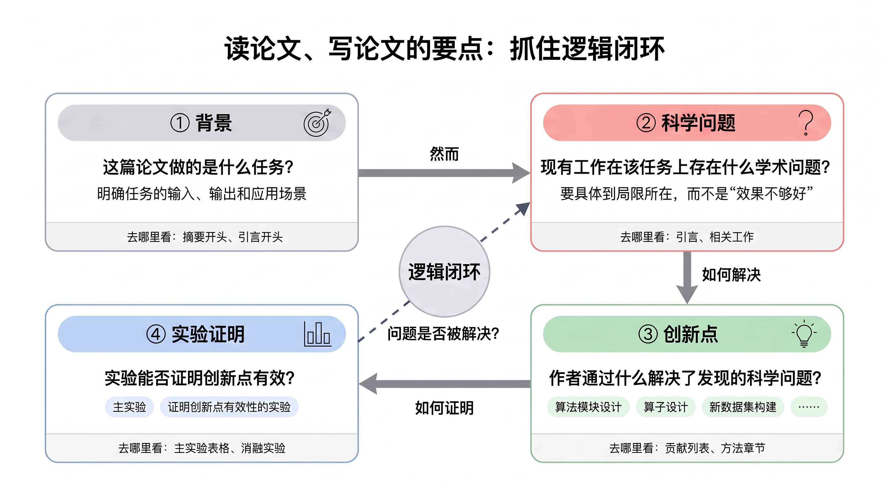

# ai-paper-reader：AI 论文精读 Skill

一个用于 CodeBuddy Code 的论文精读技能。它把人工智能、机器学习、深度学习、大模型、NLP、CV、数据挖掘等领域的论文，整理成**可核验的中文 Markdown 精读文档**，而不是逐节复述原文。

核心思路是抓住论文的**逻辑闭环**：

**背景（做什么任务）→ 科学问题（现有工作有什么学术问题）→ 创新点（作者用什么解决）→ 实验证明（实验能否证明创新点有效）→ 对我的研究方向的启发**



## 主要特点

- **逻辑闭环组织**：先梳理“科学问题 → 创新点 → 实验证据”的对应关系；某项创新缺少直接实验支撑时，如实写明证据边界，不拿整体性能提升替代模块有效性证明。
- **双摘要开头**：摘要一按逻辑闭环概括全文，并给出带数据集、指标、基线和具体数值的实验结论；摘要二为原摘要的完整、忠实中文翻译。
- **严格的证据规范**：
  - 关键事实标注原文页码、章节、图号或表号；
  - 实验结果写明数据集、设置、指标、比较对象和具体数值，优先使用“从 A 提升到 B，绝对提高 B−A 个百分点”的表达；
  - 不用“大幅提升”“效果显著”等定性措辞代替数据，原文未报告的数值不补造；
  - 区分论文事实、作者声称的结论和阅读者分析。
- **只保留关键实验**：只展示主实验和能证明创新点有效的消融、替换、对照或诊断实验。
- **原文图表截图**：具备 PDF 渲染或截图能力时，截取原文方法框架图、主实验图表和关键消融图表，以相对路径插入文档；不重绘、不生成虚构图表。
- **结合个人研究方向**：从长期记忆中读取用户的研究方向，给出具体帮助、可借鉴之处、适用边界与风险；记忆中没有记录时如实说明，不虚构研究方向。
- **沉淀学习成果**：精读完成后，把凝练的要点（任务、科学问题、创新机制、关键数据、启发）写入长期记忆，供后续对比和复用。

## 输出文档结构

```text
# 论文阅读：［论文中文题名］
## 摘要一：逻辑闭环
## 摘要二：论文原摘要中文翻译
## 背景            （任务定义、现有技术路线）
## 科学问题        （逐条说明表现、深层原因与原文依据）
## 创新点          （回应的问题、具体设计、作用机制、原文依据）
## 实验证明        （主实验、创新点有效性验证）
## 对我的研究方向的启发与可借鉴之处
```

## 安装

将本仓库克隆到 CodeBuddy Code 的用户级 skills 目录下（所有项目可用），目录名为 `ai-paper-reader`：

```bash
git clone https://github.com/ZZiCai/skill.ai-paper-reader.git ~/.codebuddy/skills/ai-paper-reader
```

也可以只下载 `SKILL.md`，手动放到 `~/.codebuddy/skills/ai-paper-reader/SKILL.md`。安装后新开一个会话即可加载。

## 使用

上传论文 PDF、提供论文链接或题名，并提出“精读”“解读”“阅读笔记”“逻辑闭环”“创新点分析”等要求时会自动触发；也可以手动调用：

```text
/ai-paper-reader 读论文 @paper/xxx.pdf
```

建议在首次使用前告诉 Agent 你的研究方向（例如“我的研究方向是反洗钱图学习”），并让它记入长期记忆，这样“对我的研究方向的启发”一节会更有针对性。

## 仓库结构

```text
.
├── SKILL.md    # Skill 定义（触发描述、执行流程、证据规范、输出模板）
├── fig.png     # 读论文的逻辑闭环示意图
└── README.md
```

## 注意事项

- 精读质量依赖论文全文；只有摘要时，Skill 会要求提供全文，而不会凭摘要编造方法细节或实验数值。
- 截图功能依赖运行环境的 PDF 渲染或图像处理能力；没有该能力时只用文字和表格呈现，并标明原图表位置。
- 从柱状图等图中读取的近似数值会在文档中显式标注，使用前请对照原文核对。
